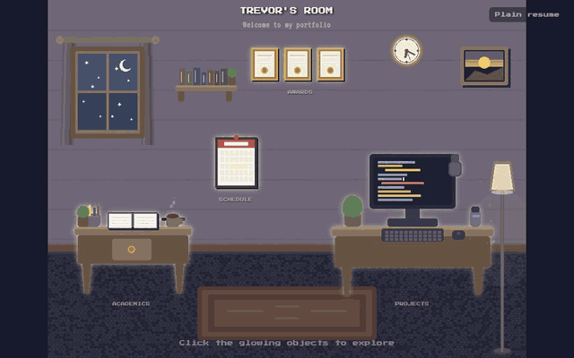
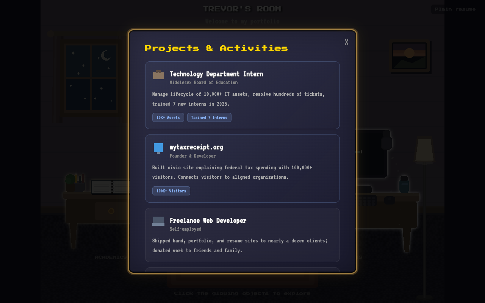
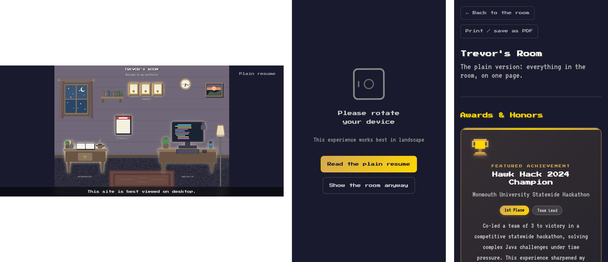
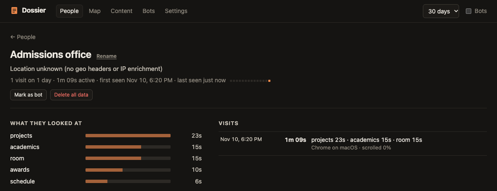

# Trevor's Room

My college resume, except it's a room.



**Live: [trevorrosato.vercel.app](https://trevorrosato.vercel.app)** · [plain version](https://trevorrosato.vercel.app/resume)

It's a cozy pixel-art bedroom drawn entirely in [PixiJS](https://pixijs.com) (no image files, every book and plant is a `Graphics` call). The four things that glow are the resume:

| In the room | What's in it |
| --- | --- |
| Framed certificates | Awards & honors |
| Wall calendar | Senior year schedule |
| Study desk | Academics (GPA, SAT) |
| Computer desk | Projects & extracurriculars |

Click one and a panel opens with the details. The clock on the wall shows the real time, because of course it does.



## The plain version

Not everyone wants to explore a room to read a resume, and a canvas is invisible to screen readers and search engines. So [`/resume`](https://trevorrosato.vercel.app/resume) has the exact same content as a normal page: real text, rendered into the HTML at build time, works without JavaScript or WebGL, and prints cleanly to PDF.

The room links to it from the corner, from the loading screen if loading is slow or fails, and from the "please rotate your device" screen on phones (which also has a "show the room anyway" button now, for people with rotation lock on).



The room itself also works with a keyboard: Tab moves between the four objects (they light up), Enter opens, Escape closes. If WebGL isn't available it falls back to WebGPU or plain Canvas 2D, and `prefers-reduced-motion` stills everything except the clock.

## Why there's analytics in a resume

I built this to send to a handful of specific people, like an admissions office. The only question I actually had afterwards was "did they look?", and normal analytics can't answer that. "12 visitors this week" doesn't tell you whether one of them was the person you were waiting on.

So I built **[Dossier](https://github.com/trevor050/dossier)** alongside it. The two are a pair:

- Each person gets their own link, like `trevorrosato.vercel.app/?to=admissions-office`. The tag is read and then removed from the address bar, so it doesn't show up if they share or bookmark it.
- The room tells Dossier which panel is open (`dossier.enter('projects')` / `dossier.leave('projects')`), and the plain resume's sections are timed under the same names. Time only counts while the tab is visible and someone is actually there.
- The dashboard (`/api/admin`, same Vercel project) shows, per link: opened or not, when, how long, and what they looked at.



<sub>That's from Dossier's local demo mode after a scripted walkthrough of this room, not a real visitor.</sub>

Session replay is off here on purpose: the room is a `<canvas>`, so a DOM replay would be mostly blank, and recording canvas frames is heavy. Browsers that send Global Privacy Control or Do Not Track aren't tracked, `?dossier=off` opts anyone out, and `?internal=1` is how I keep my own devices out of the numbers. Dossier and PostHog skip dev builds and Vercel preview deployments entirely.

## Running it

Needs Node 20.19 or newer.

```bash
npm install          # Dossier installs from GitHub and builds itself, give it ~30s
npm run dev          # http://localhost:5173 (analytics are off in dev)
npm test
npm run build && npm run preview
```

To see the tracking work end to end without a database, run Dossier's demo next to a production build:

```bash
npm run dossier:demo                                   # dashboard on an in-memory Postgres at :8787
npm run build && DOSSIER_URL=http://localhost:8787 npm run preview
```

Open `http://localhost:4173/?to=someone`, click around, and you'll show up at `http://localhost:8787/api/admin` a few seconds later. Automated browsers get filed under Bots (they announce themselves with `navigator.webdriver`), so use a normal one.

### Deploying

It's a Vercel project: static site from `vite build`, plus two functions in `api/` that are one-line re-exports of Dossier. Set `DATABASE_URL` and `DOSSIER_ADMIN_TOKEN` (16+ characters) in the project, run `npx dossier migrate` once against that database, and deploy. PostHog is optional (`VITE_PUBLIC_POSTHOG_KEY`); everything else is in [`.env.example`](.env.example).

## Making it your own

- **The words** all live in [`src/content.ts`](src/content.ts), one HTML snippet per object. Each needs an `<h2>`; it becomes the panel's title and the section heading on `/resume`.
- **The room** is drawn in [`src/scene.ts`](src/scene.ts) on an 800×600 grid. `buildRoom()` returns the clickable objects; each one's `key` has to match a key in `content.ts`.
- **Your URL** goes in `SITE_URL` (or the default in `vite.config.ts`) so link previews and canonical URLs point at your site. Swap `public/og.png` for a 1200×630 screenshot of your room.
- **Analytics** are in [`src/analytics.ts`](src/analytics.ts) if you want to change what's tracked or drop something.
